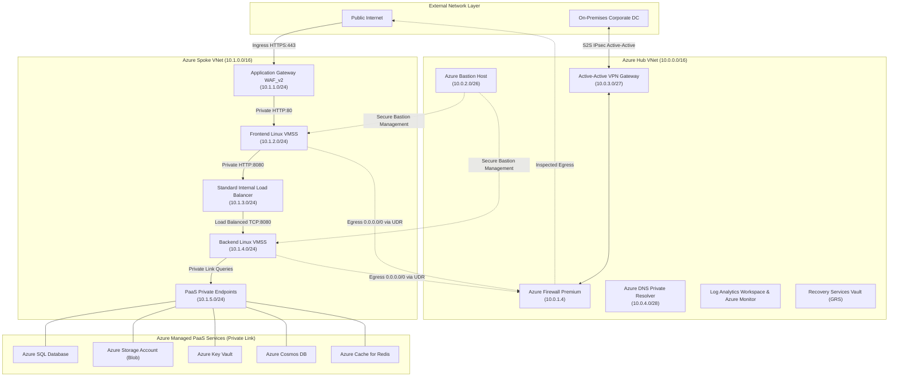
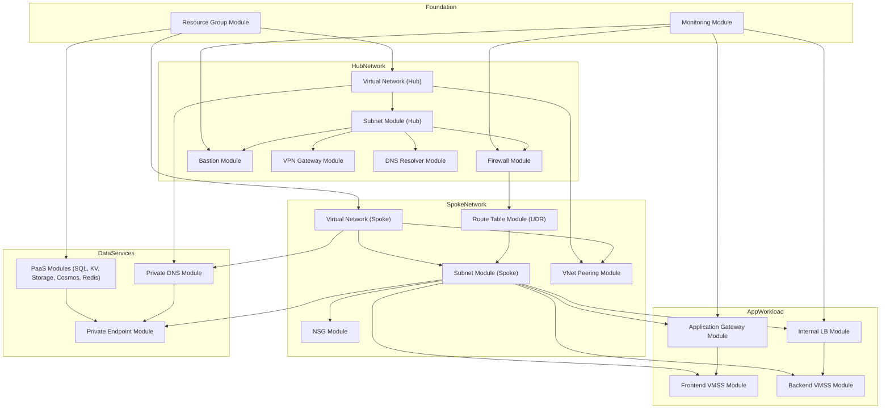

# Enterprise Azure Hub-and-Spoke High Availability Architecture

## 1. Executive Summary

This architecture establishes an enterprise-grade cloud landing zone within Microsoft Azure designed for mission-critical production workloads. Adhering to the Microsoft Cloud Adoption Framework (CAF) and Azure Well-Architected Framework (WAF), this architecture isolates centralized security, connectivity, and identity in a **Hub Virtual Network (10.0.0.0/16)** while delegating application hosting to an isolated **Spoke Virtual Network (10.1.0.0/16)**.

---

## 2. Overall Architecture Diagram

---

## 3. Core Architectural Pillars

### A. High Availability & Multi-Zone Redundancy
- **Availability Zones**: All gateway and compute instances (Firewall, Bastion, VPN Gateway, Application Gateway, Frontend VMSS, Internal LB, Backend VMSS) are deployed with multi-zone distribution across Zones `1`, `2`, and `3`.
- **Autoscaling**: Both Application Gateway (min 2, max 10 instances) and VMSS tiers automatically scale horizontally based on workload demand.
- **Health Probing**: Continuous health check probing monitors node availability and automatically removes degraded instances from traffic pools without service disruption.

### B. Network Isolation & Zero Trust
- **No Direct Public IPs**: Compute VMs are private-only. Individual scale set instances have zero public IP addresses.
- **Perimeter Defense**: Ingress traffic is inspected by Application Gateway WAF_v2 with OWASP Core Rule Sets in Prevention mode. Egress traffic from all workloads is forced through Azure Firewall Premium via User Defined Routes (UDRs).
- **Subnet Microsegmentation**: Dedicated Network Security Groups (NSGs) protect each subnet tier with default-deny rules.

### C. Private PaaS Connectivity
- All Azure PaaS resources (SQL Database, Blob Storage, Key Vault, Cosmos DB, and Redis) have public network access strictly disabled.
- In-transit traffic flows entirely across the Azure private backbone via Private Endpoints and Private DNS zones.

---

## 4. Terraform Module Dependency Flow

