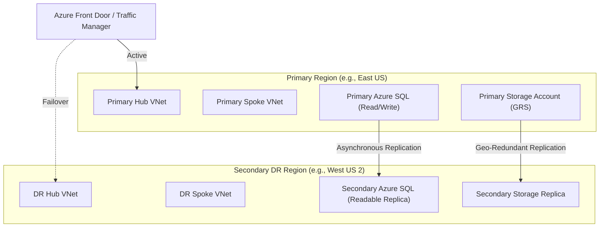

# Disaster Recovery and Business Continuity Plan

## 1. Disaster Recovery Objectives

The disaster recovery design balances recovery speed and cost:

| Tier | Component | RTO Target | RPO Target | Strategy |
|---|---|---|---|---|
| **Tier 1 (Compute)** | Frontend & Backend VMSS | < 30 minutes | 0 (Stateless) | IaC Redeployment / Zone Redundant |
| **Tier 1 (Database)**| Azure SQL Database | < 15 minutes | < 5 seconds | Active Geo-Replication / Failover Groups |
| **Tier 2 (Storage)** | Azure Blob Storage | < 1 hour | < 15 minutes | Geo-Redundant Storage (GRS) |
| **Tier 2 (Secrets)** | Azure Key Vault | < 15 minutes | 0 (Replicated) | Azure PaaS Regional Pair Redundancy |
| **Tier 3 (Cache)**   | Azure Cache for Redis | < 1 hour | Ephemeral | Automated warm reload on recovery |

---

## 2. Multi-Region Disaster Recovery Topology



---

## 3. Backup Policies & Recovery Services Vault

### VM Backup Configuration
- **Vault Configuration**: Recovery Services Vault deployed in the Hub with `storage_mode_type = "GeoRedundant"`.
- **Retention Schedule**:
  - Daily snapshots retained for 30 days.
  - Weekly full backups retained for 4 weeks.
  - Monthly archives retained for 12 months for compliance.
- **Soft Delete**: Enabled with a 14-day retention buffer preventing accidental or malicious deletion.

---

## 4. Failover and Failback Execution Procedures

### Failover Procedure (Primary Outage Declared)
1. **Declare Disaster**: Incident Commander authorizes failover invocation.
2. **Initiate Database Failover**:
   ```bash
   az sql db failover --resource-group gd-ent-prod-eus-data-rg --server gd-ent-prod-eus-sqlsvr --name gd-ent-prod-eus-db
   ```
3. **Execute Secondary Region Terraform Pipeline**:
   ```bash
   cd environments/dr
   terraform init
   terraform apply -var="failover_active=true" -auto-approve
   ```
4. **Update Traffic Routing**:
   Point global DNS/Traffic Manager endpoints to the secondary region Application Gateway public IP.

### Failback Procedure (Primary Region Restored)
1. Verify primary region stability and telemetry for at least 2 consecutive hours.
2. Synchronize modified state back to the primary database.
3. Switch primary roles and fail back global traffic in an off-peak maintenance window.
