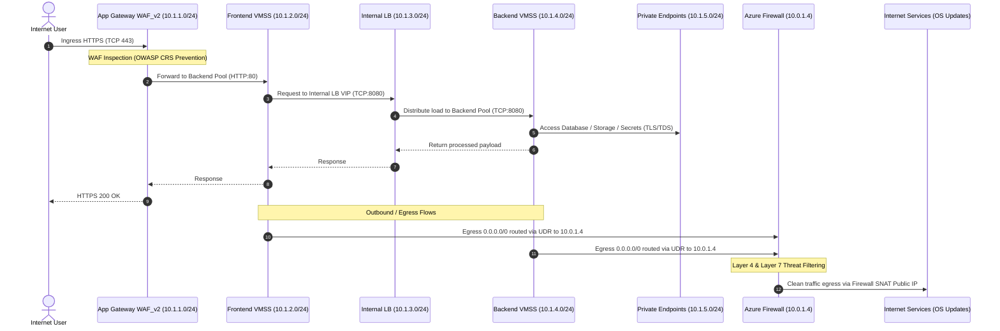

# Network Design and Traffic Engineering Specification

## 1. Network Address Allocation Plan

Non-overlapping RFC 1918 private address spaces are assigned across the topology.

### A. Hub Virtual Network (`10.0.0.0/16`)

| Subnet Name | CIDR Prefix | Usable IPs | Dedicated Purpose | Minimum Requirement |
|---|---|---|---|---|
| `AzureFirewallSubnet` | `10.0.1.0/26` | 59 | Azure Firewall core data-plane | /26 per Azure requirement |
| `AzureFirewallManagementSubnet` | `10.0.1.64/26` | 59 | Azure Firewall management/tunneling | /26 per Azure requirement |
| `AzureBastionSubnet` | `10.0.2.0/26` | 59 | Azure Bastion managed host | /26 per Azure requirement |
| `GatewaySubnet` | `10.0.3.0/27` | 27 | Active-Active VPN Gateway | /27 per Azure requirement |
| `InboundDnsResolverSubnet` | `10.0.4.0/28` | 11 | Azure DNS Private Resolver Inbound | /28 with delegation |
| `OutboundDnsResolverSubnet` | `10.0.4.16/28` | 11 | Azure DNS Private Resolver Outbound | /28 with delegation |
| `SharedServicesSubnet` | `10.0.5.0/24` | 251 | Jump hosts, monitoring agents | /24 standard sizing |

### B. Spoke Virtual Network (`10.1.0.0/16`)

| Subnet Name | CIDR Prefix | Usable IPs | Dedicated Purpose | Routing / NSG Control |
|---|---|---|---|---|
| `AppGatewaySubnet` | `10.1.1.0/24` | 251 | Application Gateway WAF_v2 | Direct Internet Route (0.0.0.0/0 -> Internet) |
| `FrontendSubnet` | `10.1.2.0/24` | 251 | Frontend Linux VMSS | UDR forced egress (0.0.0.0/0 -> 10.0.1.4) |
| `InternalLbSubnet` | `10.1.3.0/24` | 251 | Standard Internal Load Balancer | Isolated tier-2 balancing |
| `BackendSubnet` | `10.1.4.0/24` | 251 | Backend Linux VMSS | UDR forced egress (0.0.0.0/0 -> 10.0.1.4) |
| `PrivateEndpointSubnet` | `10.1.5.0/24` | 251 | Azure PaaS Private Endpoints | Network policies disabled, private link only |

---

## 2. Traffic Flow & Routing Topology

---

## 3. Asymmetric Routing Prevention & UDR Guidelines

### Rule 1: Application Gateway v2 Subnet Requirement
Microsoft Application Gateway v2 instances maintain dynamic keep-alives and control-plane management with the Azure platform infrastructure via port range `65200-65535`. Forcing `0.0.0.0/0` in `AppGatewaySubnet` to Azure Firewall will cause asymmetric routing drops and break public return traffic.
- **Requirement**: `AppGatewaySubnet` route table directs `0.0.0.0/0` with next hop `Internet`.

### Rule 2: Workload Subnets (Frontend & Backend)
Workload instances in `FrontendSubnet` and `BackendSubnet` possess no public IPs. All egress traffic targeting internet destinations (package downloads, security patches, external API calls) is directed to the Azure Firewall Private IP (`10.0.1.4`) using User Defined Routes (`0.0.0.0/0` -> `VirtualAppliance` `10.0.1.4`).

---

## 4. Subnet Security Group Matrix (NSG)

| Subnet | Inbound Allowed | Inbound Denied | Outbound Allowed |
|---|---|---|---|
| `AppGatewaySubnet` | Ports 80, 443 from `Internet` Ports 65200-65535 from `GatewayManager` Health probes from `AzureLoadBalancer` | All other ports | All outbound traffic |
| `FrontendSubnet` | Port 80 from `10.1.1.0/24` (AppGateway) Port 22 from `10.0.2.0/26` (Bastion) | Deny all other inbound (`*`) | Outbound to ILB (`10.1.3.0/24`) and Hub Firewall (`10.0.1.4`) |
| `InternalLbSubnet` | Port 8080 from `10.1.2.0/24` (Frontend) Probes from `AzureLoadBalancer` | Deny all other inbound (`*`) | Outbound to Backend (`10.1.4.0/24`) |
| `BackendSubnet` | Port 8080 from `10.1.3.0/24` (ILB) Port 22 from `10.0.2.0/26` (Bastion) | Deny all other inbound (`*`) | Outbound to Private Endpoints (`10.1.5.0/24`) and Firewall (`10.0.1.4`) |
| `PrivateEndpointSubnet` | Ports 443, 1433, 6380 from `10.1.4.0/24` | Deny all inbound from Internet | Azure Private Link internal |
