# Enterprise Security and DevSecOps Architecture

## 1. Zero Trust Principles & Implementation

This architecture adheres strictly to Zero Trust: **Verify Explicitly**, **Use Least Privilege Access**, and **Assume Breach**.

```mermaid
flowchart LR
    subgraph Identity["Identity & Access Control"]
        Entra["Microsoft Entra ID"]
        MSI["System-Assigned Managed Identity"]
        RBAC["Azure RBAC (Least Privilege)"]
    end

    subgraph DataProtection["Data & Secret Protection"]
        KV["Azure Key Vault (RBAC, Purge Protection)"]
        TDE["Transparent Data Encryption (SQL/Cosmos)"]
        SSE["Storage Service Encryption (TLS 1.2 Enforced)"]
    end

    subgraph Perimeter["Perimeter & Network Defense"]
        WAF["Application Gateway WAF (OWASP 3.2 Prevention)"]
        FW["Azure Firewall Premium (IDPS & TLS Inspection)"]
        PE["Private Endpoints (Disabled Public Network Access)"]
        Bastion["Azure Bastion (No Public VM IPs)"]
    end

    Identity --> Perimeter
    Perimeter --> DataProtection
```

---

## 2. Security Controls by Layer

### Layer 1: Identity and Access Management
- **Managed Identities**: VMSS compute instances utilize Azure System-Assigned Managed Identities for seamless authentication against Azure Key Vault and SQL Databases, eliminating stored credentials in configurations.
- **Role-Based Access Control (RBAC)**: All PaaS resources enforce Azure RBAC. Classic shared access signatures and account keys are minimized.
- **Pipeline OIDC**: CI/CD deployment pipelines utilize OpenID Connect (OIDC) federation with Microsoft Entra ID. No long-lived client secrets or certificates exist within GitHub Actions repository secrets.

### Layer 2: Network Perimeter & Threat Prevention
- **Application Gateway WAF_v2**: Deployed in `Prevention` mode for production environments with OWASP Core Rule Set 3.2 enabled, protecting against SQL injection, cross-site scripting (XSS), and HTTP protocol violations.
- **Azure Firewall Premium**: Centralizes egress inspection with threat intelligence-based filtering and intrusion detection/prevention systems (IDPS).
- **Subnet Microsegmentation**: All subnets enforce inbound default-deny NSG rules with stateful traffic inspection.
- **Private Link**: Azure SQL, Blob Storage, Key Vault, Cosmos DB, and Redis are completely unroutable from the public internet.

### Layer 3: Secrets & Data Security
- **Azure Key Vault**: Configured with `purge_protection_enabled = true`, soft-delete retention (90 days), and firewall default action `Deny`.
- **Data Encryption at Rest**: 256-bit AES encryption across Storage Accounts, transparent data encryption (TDE) for Azure SQL, and hardware-level encryption across Cosmos DB storage engines.
- **Data Encryption in Transit**: Minimum TLS version 1.2 enforced across all storage accounts, databases, and application listeners.

---

## 3. Automated DevSecOps Governance

The infrastructure repository integrates multi-tier automated security analysis:

1. **Static IaC Code Analysis (Checkov)**: Scans every pull request against CIS Azure Benchmarks, validating encryption, network access flags, and resource policies.
2. **Terraform Linter (TFLint)**: Validates syntax, naming conventions, and AzureRM resource structure against the official Azure ruleset.
3. **Secret Scanning (GitLeaks)**: Validates that no private keys, passwords, or cloud tokens are committed to source control.
4. **Cost Governance (Infracost)**: Calculates detailed operational cost breakdowns on pull requests before applying changes.
